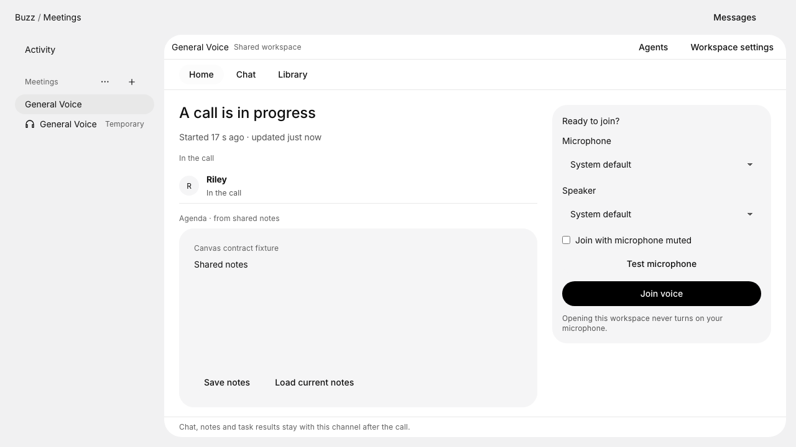
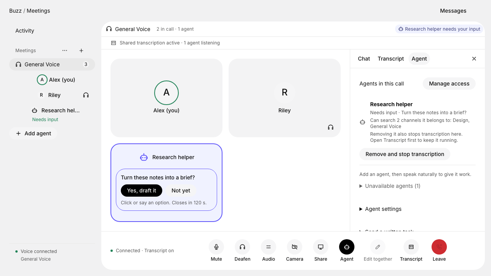
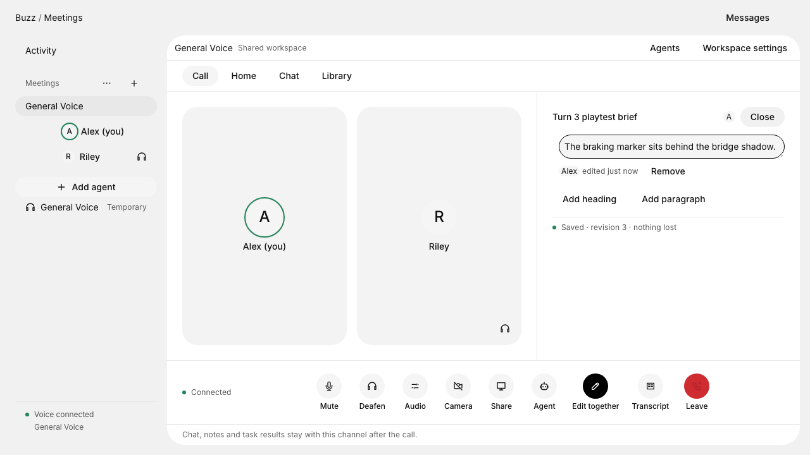
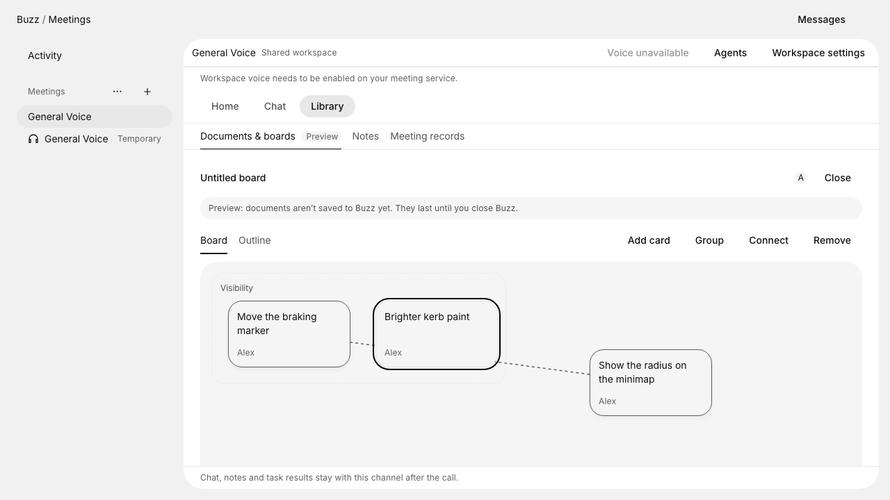
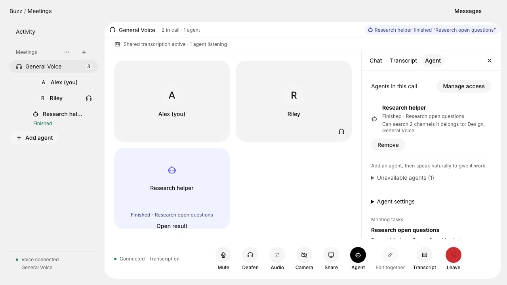
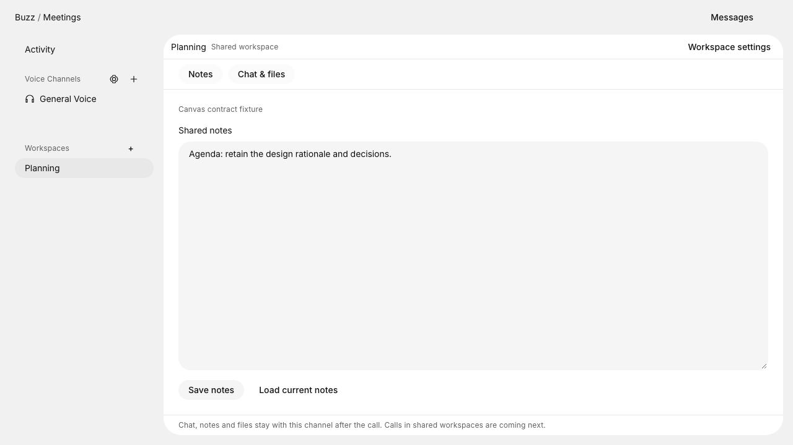

# Buzz Meetings

Meetings for [Buzz](https://github.com/block/buzz): a persistent place for a team's calls, with
voice, screen sharing, live transcripts, and agents that listen, ask, and do the work while you talk.
It is a Buzz plugin plus a small self-hosted service. No Buzz desktop changes.


> **0.3.0 is a pre-release.** It has been tested in browsers against real LiveKit, the Rust
> service and a local Whisper model. In the Buzz desktop app it has been loaded and smoke-tested,
> not fully accepted. See [Status](#status).

## What you get

| | |
| --- | --- |
| **A home for each meeting.** Check your audio, see who is already there, and join. Opening it never turns on your microphone. |  |
| **Agents you talk to.** Add one of your Buzz agents to a call and give it work by speaking. When it needs a decision, it asks on its own tile; click or say the answer. |  |
| **Work beside the call.** Edit a shared document while the call continues. Each paragraph shows who wrote it, and a clash is held for you to choose. *Preview.* |  |
| **A whiteboard.** Cards, groups and connectors, a keyboard outline, and "Turn into a brief". *Preview.* |  |
| **Work that reports back.** The agent's tile shows listening, working, needs input or finished, and its results are listed in the Agent panel and saved in the channel. |  |
| **One library.** Documents and boards, notes, and meeting records for the workspace in one place. |  |

Also included: speaker-attributed live transcripts you can search, copy, download, or
deliberately save to the channel as a meeting record.

Screenshots come from the browser test host. Media, the service and speech recognition in
them are real; Buzz's own chat and notes panels and the agent are stand-ins.

## Quick start

You need a Buzz community, a Linux host with Docker, and a hostname with TLS.

### 1. Run the service

```sh
git clone https://github.com/h2s2-studio/buzz-meetings && cd buzz-meetings

printf '%s\n' \
  "LIVEKIT_URL=wss://meetings.example.org" \
  "LIVEKIT_NODE_IP=203.0.113.10" \
  "LIVEKIT_API_KEY=$(openssl rand -hex 16)" \
  "LIVEKIT_API_SECRET=$(openssl rand -hex 32)" \
  "MEETING_ACCESS_KEY=$(openssl rand -hex 32)" > meetings.env
chmod 600 meetings.env

docker compose --env-file meetings.env -f deploy/compose.yaml up -d --build
curl -fsS https://meetings.example.org/health
```

Replace the hostname and the media IP with yours. Put your TLS proxy in front: `/rooms` and
`/health` go to port 8091, everything else to 7880 ([Caddy example](deploy/Caddyfile.example)).
Open TCP 7881 and UDP 7882 for media.

That gives you voice, cameras and screen sharing. Two optional additions:

- **Transcripts and agents:** start the `speech` profile and set `MEETING_TRANSCRIBER_URL`.
  Speech recognition runs on your machine with faster-whisper; no external account.
- **Private workspace calls tied to channel membership:** set `MEETING_RELAY_URL`,
  `MEETING_RELAY_PUBLIC_KEY` and `MEETING_IDENTITY_FILE`.

The exact steps, firewall notes and rollback are in the [deployment guide](docs/deployment.md)
and the [live agents guide](docs/live-agents.md#speech-service).

### 2. Install the plugin

1. In Buzz, open **Settings → Plugins → Manage plugins → Add**.
2. Paste `https://github.com/h2s2-studio/buzz-meetings`, choose **Find → Install plugin**, and
   enable **Meetings**. Pin **Branch or tag** to `v0.3.0`, or leave it empty to follow `main`.
3. If the service is on its own hostname, open **Settings → Meetings → Connection settings** and
   enter `wss://meetings.example.org/rooms` and the access key.

The repository root contains the built `plugin.js` and `manifest.json`; Buzz does not run a build.

### 3. Hold a meeting

1. Open **Meetings** in the dock, choose **+**, name the meeting and create it.
2. On **Home**, check your microphone and choose **Join voice**.
3. Share a screen, open **Transcript**, and choose **Agent** to add one of your agents.
   Then just talk to it.

## How it works

- **A meeting is a Buzz channel.** Its chat, notes, files and saved records live there under
  the channel's own permissions and stay after the call.
- **The service admits people to calls.** A Rust broker issues short-lived LiveKit tokens. For
  workspace calls it verifies a signature from your Buzz identity and your current channel
  membership, and removes people whose access is revoked.
- **Speech stays on your server.** One worker transcribes each microphone separately, so
  overlapping speakers stay attributed.
- **Agents are your own Buzz agents.** They act with their ordinary permissions through Buzz's
  agent tools. Speech can give them work and answer questions they ask; it cannot grant
  permissions.

More: [using Meetings](docs/guide.md) · [product and architecture](docs/product.md) ·
[live agents](docs/live-agents.md) · [transcripts](docs/transcription.md) ·
[workspaces](docs/persistent-workspaces.md) · [deployment](docs/deployment.md)

## Status

| Area | State |
| --- | --- |
| Voice, cameras, screen sharing, stage and filmstrip | Works; browser-tested with real media |
| Workspaces, chat, notes, meeting records | Works; uses Buzz's own channel features |
| Live transcripts | Works with the speech profile deployed |
| Agents in a call, in-call questions, search of earlier meetings | Works in tests with a stand-in agent; not yet accepted with a real agent in the desktop app |
| Documents and whiteboards | Preview: kept in memory, not saved to Buzz, agents cannot write to them yet |
| An agent's own live screen | Not built |

Known limits:

- Local camera capture does not work in the official macOS Buzz 1.0.4 build, which lacks the
  camera entitlement. Receiving camera video works.
- Only an agent's owner can answer its question by clicking; others answer by speaking.
- Physical devices, screen readers, long calls, restrictive networks and capacity have not
  been validated. The service's limits are protective defaults, not benchmarks.

## Develop

```sh
npm ci
npm run build && npm run check:build
npm test
cargo test --locked --workspace
npx playwright install chromium webkit
LIVEKIT_SERVER_BIN=livekit-server npm run test:media
```

To iterate inside Buzz, install the folder through **Manage plugins → Add → Browse**, then
reload after rebuilding. Changes are welcome as pull requests; each one should say what it
verified and what it did not.

Buzz Meetings consolidates the H2S2 Studio voice-channel and screen-sharing prototypes; their
history is retained here. Apache-2.0; see [LICENSE](LICENSE) and
[THIRD_PARTY_NOTICES](THIRD_PARTY_NOTICES).
