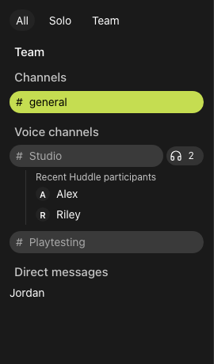

# Voice channels for Buzz

A sidebar prototype from H2S2 Studio. Mark existing Team channels for voice and see recent Huddle participants directly beneath their channel rows. It uses Buzz’s built-in Huddles and the existing community relay.



The screenshot uses fixture data rendered with Buzz’s desktop styles.

## Install from GitHub

1. In Buzz Desktop 1.0.4, open **Settings → Plugins → Manage plugins → Add**.
2. Paste `https://github.com/h2s2-studio/buzz-voice-channels` into **Git or GitHub repository**.
3. Set **Branch or tag** to `v0.1.0` to pin the pilot. Leave **Folder** empty, then select **Find → Install plugin** and enable **Voice channels**.
4. Select your community and open its **Voice channels** settings card. Check one or more existing Team channels.

Tagged releases include the built `plugin.js` and `manifest.json` at the repository root. To follow the default branch, leave **Branch or tag** empty when installing and use **Check for updates** later.

## Try it in Buzz

- With **All** or **Team** selected, find the marked channels in the main sidebar. For a dedicated group, use **Channels → ⋯ → Create section**, name it **Voice channels**, and move the marked channels into it using Buzz’s sidebar.
- Open a marked room and click the **headphones button** in its conversation header to start or join the native Huddle. Recent participant names and a collapsible count appear beneath the room when the relay provides Huddle events.
- Enable **Show sample roster** in the plugin’s settings to see the occupied layout on your own. Sample people are labeled and appear only on marked rooms without any recent participants.
- Channel choices are local to this device and community. Operators can also opt channels in for members by applying the `h2s2:voice` channel label through their existing channel management tools.

Buzz handles microphone permission, the call, and leaving voice. This pilot opens the conversation for joining and treats the roster as recent event evidence. Presence can lag by a refresh or outlast an abrupt disconnect until the call expires. Accurate live presence and a dedicated join action are the next native integration milestone. [Buzz Huddles](https://github.com/block/buzz-app/blob/v1.0.4/docs/huddles.md) · [Buzz sidebar API](https://github.com/block/buzz-app/blob/v1.0.4/docs/plugin-architecture.md#decorating-host-sidebar-rows-and-adding-sort-modes)

## Development

```sh
npm ci
npm run build
npm run check:build
npm test
npx playwright install chromium webkit
npm run test:browser
```

The plugin uses TypeScript and Buzz’s injected React. The browser fixture exercises the generated module against the desktop sidebar and relay contracts. Releases are published under [H2S2 Studio](https://github.com/h2s2-studio).

See other community projects in the [Buzz plugins catalog](https://github.com/h2s2-studio/buzz-plugins).
