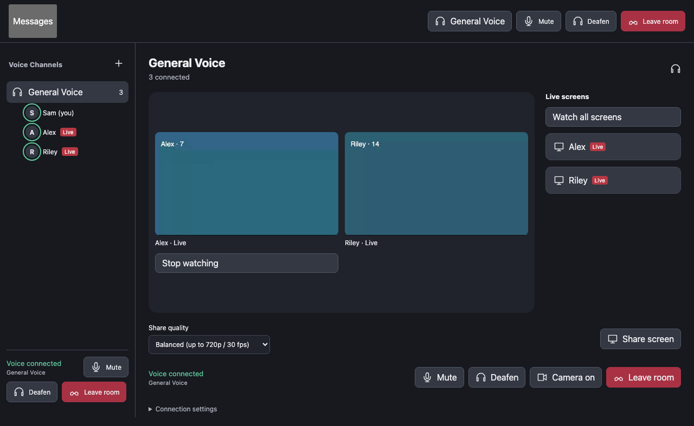

# Buzz Meetings

Voice rooms and persistent shared workspaces in one Buzz app. Link a permanent
Buzz channel to keep its notes, conversation, and files available between calls.
Existing voice rooms support cameras and simultaneous screen sharing through
the Rust admission server and LiveKit.



## Install in Buzz

1. Open **Settings → Plugins → Manage plugins → Add**.
2. Paste `https://github.com/h2s2-studio/buzz-meetings` into **Git or GitHub repository**.
   Leave Folder empty. Choose **Find → Install plugin** and enable **Meetings**.
3. Open **Meetings** in the app dock. Its **Voice Channels** sidebar includes
   **General Voice** automatically.
4. Click the room to join. Allow microphone permission when your system asks.
   Your avatar and name appear after connecting. Click **Share screen** to choose
   a screen or window in the system picker. Use **Watch** to view someone’s
   stream, or **Watch all screens** for a grid.

Your community must run the [Meetings deployment](docs/deployment.md). By default,
the app uses the community’s `/rooms` endpoint. For a separate service, open
the room header’s **Connection settings** button and enter its `wss://…/rooms` address and access key.
Access keys stay in memory and are cleared when your identity or community changes.

The root contains the built `plugin.js` and `manifest.json`; Buzz does not run a
build at install. Pin **Branch or tag** to `v0.2.1` for this release, or leave it
empty to follow main and use **Check for updates**.

## Shared workspaces

1. Choose **+** beside **Workspaces** in the Meetings sidebar.
2. Link a permanent channel you have joined, or create a workspace. New workspaces
   default to private; choose **Open to the community** explicitly if wanted.
3. Open the workspace and use **Notes** or **Chat & files**. Notes use Buzz's
   native Canvas editor; conversation and attachments use its native chat UI.
4. Other channel members using Meetings discover the saved workspace through
   Buzz's artifact synchronization. Owners and admins can rename it in
   **Workspace settings** without moving its content or changing its identity.

Opening a workspace does not request the microphone. Its content remains in the
same permanent Buzz channel after closing Meetings or restarting Buzz. Native
Canvas uses revision checks to preserve conflicting drafts; reload Notes to see
another person's edits. It does not provide simultaneous document editing.

Shared workspaces and existing voice shortcuts remain separate in this release.
You can keep an existing call connected while browsing a workspace, but joining
voice through a workspace awaits admission verified against that channel's
membership. See [workspace behavior and recovery](docs/persistent-workspaces.md).

## In a room

- Mute, deafen, turn your camera on/off, or leave from the call controls.
  Deafen also mutes your microphone; undeafening leaves it muted until you unmute.
- If camera access is blocked, use **Open camera settings** on macOS or Windows,
  allow Buzz, then choose **Try camera again**. Linux shows manual
  guidance. The settings shortcuts require reviewing the plugin's two
  fixed host commands when updating; they never change permission themselves.
  Local camera capture is unavailable in the official macOS Buzz 1.0.4 build
  tested for this release: that app lacks the required camera declaration and
  entitlement. The plugin cannot enable it through settings. Receiving camera
  video from others does not require local camera permission.
- Click a screen preview or participant avatar to put it on your main stage.
  Click the selected item again to return to the participant grid. Your choice
  affects only your window. **Watch all screens** shows simultaneous remote shares.
- Change your screen source without ending the call. Stop sharing independently
  of leaving voice. Balanced and Sharp text presets offer up to 720p/30 and
  1080p/30; a focused viewer can choose available simulcast layers.
- Switch back to Messages while audio and screen sharing continue. The Buzz
  toolbar retains return-to-room, mute, deafen, and leave actions.
- Leaving, changing community/identity, or disabling the plugin stops capture
  and remote playback. Reconnecting is shown explicitly.
- Room chat uses Buzz’s native conversation reader and composer alongside the call.
  A uniquely matching joined channel is linked automatically; otherwise choose
  a channel or explicitly create an open one. Chat remains available when voice
  is disconnected.
- Add named rooms with the sidebar’s **+**, or open **Manage voice channels**
  beside it to create, rename, and remove shortcuts. Room names are saved on this
  device; others add the same name to join the same room on the same community/service.
  Removing a shortcut preserves its text conversation and other participants.
  Renaming to a different room ends your current call and keeps the linked chat.
  You can remove General Voice or clear the list without it returning after reload.

## Release boundaries

This release provides shared workspace persistence and the core room/call
workflow; it is not full Discord or Teams feature parity. The roster is live for
the voice room you joined. Cross-room occupancy and shared voice-room discovery
are not implemented. Display names and
avatars are supplied from client Buzz profiles; broker admission uses a deployment
access key or private proxy, not verified Buzz channel membership. Camera,
microphone, and screen capture depend on the desktop webview and OS permissions.
Application/system audio sharing is not implemented in this release.

Workspace chat, notes, files, and discovery use Buzz's channel permissions.
Workspace audio, session history, collaborative whiteboards, transcription, and
live agents are future work. Existing voice access keys do not authorize private
channel access. The workspace registry requires Buzz's API-v1 artifact storage,
artifact writer, channel commands, and native Channels contribution, verified
against Buzz 1.0.4 contracts.

The media workflow is exercised against the Rust broker and a real local
LiveKit instance using synthetic audio/video in Chromium and WebKit. Physical
microphone, camera, screen capture, and restrictive-network checks remain required
for your deployment. Native Huddles and its agent voice integration are separate.

Workspace browser checks use two independent identities against a shared test
service, with explicit stand-ins for Buzz's Canvas and conversation UI. They do
not replace native two-user testing. A separate authenticated production-relay
probe verified artifact creation, revision conflicts, head/history reads, and
idempotent retries; native rendering and synchronization still need smoke checks.

## Develop

```sh
npm ci
npm run build
npm run check:build
npm test
cargo fmt --all --check
cargo test --locked --workspace
cargo build --locked
npx playwright install chromium webkit
LIVEKIT_SERVER_BIN=livekit-server npm run test:media
```

For reloadable local development, install the folder through **Manage plugins →
Add → Browse** under Add from folder, then reload after rebuilding.

Buzz Meetings consolidates the H2S2 Studio voice-channels and Huddle
screen-sharing prototypes. The existing video transport and its Git history are
retained here. Apache-2.0; see [LICENSE](LICENSE) and [THIRD_PARTY_NOTICES](THIRD_PARTY_NOTICES).
