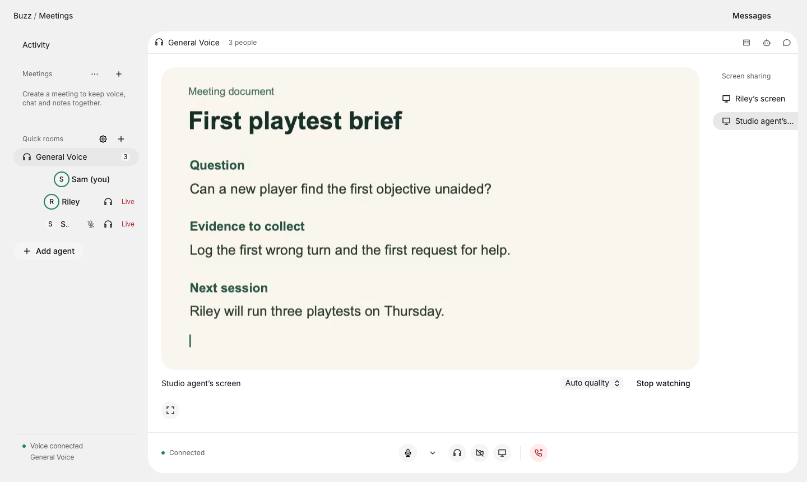
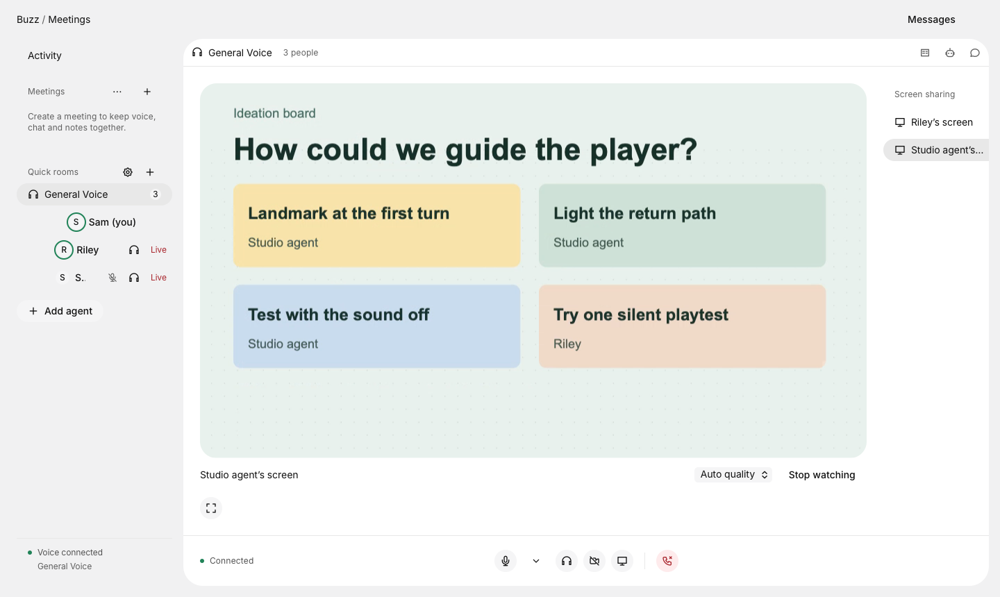

# Buzz Meetings product and engineering evaluation

Evaluate the experience from one participant’s point of view. Can I join a room, ask an agent to turn our conversation into something we can work on together, and reopen the result tomorrow? PR #5 has the room, voice, native channel content and the first agent assignment loop. The most valuable next feature is a document or whiteboard that the agent builds in front of the room and a teammate can edit while everyone watches. The most urgent fixes concern the accuracy and availability of what the meeting leaves behind.

The product baseline is Meetings `74830bb`, compared with Block’s relay `3876720`, its desktop host `1b38e05` and desktop release `v1.0.4`. Block maintains the current desktop plugin host in a separate repository from the relay and mobile client. [PR #5](https://github.com/h2s2-studio/buzz-meetings/pull/5) · [Block’s source map](https://github.com/block/buzz/blob/3876720c345bb6a9b709401707e35225e66bdb31/README.md) · [Desktop host](https://github.com/block/buzz-app/tree/1b38e05268dfbe1e45bb1e73687438ebefca8d3b)

## How a collaborative meeting should feel

Imagine a playtest review. Riley shares gameplay footage. Sam asks the studio agent to put three explanations for a missed turn on a board. A tile appears beside Riley’s share with the agent’s name and the board title. Sam watches it. Riley keeps presenting the footage. Neither person’s stage changes until they choose a source.

Riley opens **Edit together**, adds a fourth card and points to a landmark. Sam sees the edit arrive on the agent’s screen. The agent groups related ideas and offers to turn the selected cards into a test brief. Sam can correct “Friday” to “Thursday” while the agent writes the evidence section. A late joiner can open the brief, see who wrote each part and catch up without interrupting. When the agent leaves, both items stay in the workspace.

| Moment | Participant interaction | What the room should see |
| --- | --- | --- |
| Enter | Open the persistent meeting to see its people, agenda, recent work and join controls. Check audio or join muted in place. | Current occupancy with a freshness indicator. A quiet room stays useful before anyone joins voice. |
| Ask | Speak to a named agent or type a request in native chat. Choose **Document** or **Whiteboard** directly when the desired output is clear. | A brief acknowledgement naming the agent and deliverable. Listening, drafting, needs input, presenting and finished each convey different information. |
| Watch | Select **Watch** on the agent’s tile. Pin a human share or choose both. | The agent’s current page or board viewport streams under its own identity. Mute, leave, chat and the capture indicator remain reachable. |
| Edit | Open the same item beside the stage. Type or suggest a change to a paragraph. Add, move, group or connect a card. Use named pointers to discuss a location. | A committed edit updates the item and the stream. People can explore independently, then choose **Follow presenter** to rejoin its viewport. Remote motion respects reduced-motion preferences. |
| Decide | Select cards and ask the agent to draft a decision, alternatives, owner and next experiment. A person can correct the attribution or mark an item unresolved. | A linked decision and brief with supporting transcript entries, named authors and a visible draft state. An ambiguous remark stays open. |
| Leave and return | Reopen the meeting from the channel, review proposed actions and continue editing. | The record links to the board, document and task thread. It identifies the revision presented during the meeting and offers the current version. |

Claude Meetings provides a precedent for speaking a document or whiteboard into existence and finding the work on the meeting page. Discord makes the channel conversation accessible while watching a stream. Teams lets participants follow a whiteboard presenter, explore independently and resume following. Buzz already has a Huddle capsule beside search, native conversations, agent identities and an outcome-oriented Activity view. These are the interaction patterns to carry into Meetings. [Claude Meetings](https://support.claude.com/en/articles/18325154-use-claude-meetings) · [Discord voice-channel chat](https://support.discord.com/hc/en-us/articles/4412085582359-Text-Channels-Text-Chat-In-Voice-Channels) · [Teams Whiteboard Follow](https://support.microsoft.com/en-us/whiteboard/guide-participants-through-a-whiteboard-with-follow) · [Buzz Huddles](https://github.com/block/buzz-app/blob/1b38e05268dfbe1e45bb1e73687438ebefca8d3b/src/bundled/huddles/README.md) · [Buzz Activity](https://github.com/block/buzz/blob/3876720c345bb6a9b709401707e35225e66bdb31/VISION_ACTIVITY.md)

## Agent presentation experiment

The presentation probe passed in Chromium and WebKit. Two human browser clients joined the existing Meetings UI. One shared a screen. A separate scripted participant called **Studio agent** published a rendered workspace surface as a LiveKit screen-share track. A viewer watched a brief acquire a new section, then watched the same stream change into a whiteboard. A second person entered a card through an editor in their own browser session. The remote video picked up the new card, and the human’s screen remained available after the agent publisher disconnected. The probe checks decoded frames for the document edit and board changes.

| Document on the viewer’s stage | Whiteboard after Riley’s edit |
| --- | --- |
|  |  |

The receiver is the PR’s built plugin. Authoring and media admission use a local test fixture, ordinary quick-room admission and in-memory document and board objects. The publisher has a display name and its own RTC connection. Production still needs a verified binding to the Buzz agent, actual agent tool execution, durable revisions, a shared editor inside the workspace and recovery after restart. Today the existing roster counts the presenter as a person. The experiment establishes that a changing artifact can travel through the existing screen picker alongside a human share. [Runnable probe](agent-screen.probe.mjs) · [Meetings source discovery](../../src/room.ts#L124)

### Implementing the editable work

1. **Give each creation a permanent identity.** Buzz’s channel Canvas is a shared Markdown document with revision history and draft recovery. It works well for the standing agenda. The native agent’s `canvas_set` replaces the channel Canvas. Use separate channel-scoped NIP-AR artifacts for each meeting document and board so two documents, a board and the channel agenda can coexist. Associate each with its meeting occurrence, assignment thread, author and revision. [Desktop Canvas editor](https://github.com/block/buzz-app/blob/1b38e05268dfbe1e45bb1e73687438ebefca8d3b/src/bundled/channels/CanvasEditor.tsx) · [Native Canvas tools](https://github.com/block/buzz-app/blob/1b38e05268dfbe1e45bb1e73687438ebefca8d3b/src/buzz-mcp/tools.ts#L410) · [Buzz artifact contract](https://github.com/block/buzz/blob/3876720c345bb6a9b709401707e35225e66bdb31/docs/nips/NIP-AR.md)
2. **Let people and agents edit the same model.** Give document sections and board elements stable IDs. Start with headings, paragraphs, lists and links in documents, and text cards, groups, connectors and pointers on boards. An agent should be able to create an item, update a section, add or group cards, present an item and stop presenting. Run those operations through the assigned native agent handle. An edit carries its base revision and a stable operation ID. Reconcile independent edits and retain an overlapping edit for explicit resolution. Keep pointer movement, selection and viewport changes transient. NIP-AR supplies an atomic revision check, and the editor must provide the merge behavior. [Revision and access rules](https://github.com/block/buzz/blob/3876720c345bb6a9b709401707e35225e66bdb31/docs/nips/NIP-AR.md#identity-and-edits) · [Buzz plugin tool dispatch](https://github.com/block/buzz-app/blob/1b38e05268dfbe1e45bb1e73687438ebefca8d3b/src/buzz-mcp/session-tools.ts#L46)
3. **Bind presentation to the item and the speaker.** Admit a dedicated presentation publisher for the authorized agent, workspace and call occurrence. Limit it to publishing the artifact screen. Feed the renderer only the selected item and viewport. Its output joins the same stream picker as a human share. Bind the stream to the existing agent tile and label it with the artifact title. On agent removal, room exit or access loss, stop publication and live edits as appropriate. Preserve previously saved work under its channel’s access rules. [Current room publication](../../src/room.ts) · [Current agent roster](../../src/index.tsx#L222)
4. **Keep the underlying item usable during the call.** Video serves watchers. **Edit together** opens selectable document text or a keyboard-navigable outline of the board. Make fit-to-page the initial view, with zoom and follow controls. When two agents present, each gets its own tile and active item. Presenting a new document may update that agent’s tile, while a viewer editing the old item keeps their place. [Workspace surface selection](../../src/workspace-ui.tsx#L190)

## Findings to fix on PR 5

| Priority | Finding and evidence | Change and acceptance check |
| --- | --- | --- |
| High | **Resuming can duplicate speech.** A controller probe supplied 45 unique entries in service-sized pages, paused and resumed the same stream. The first replay page moved the cursor from 45 back to 20. The final transcript contained 70 rows with 45 distinct IDs. Exports and subsequent agent context can inherit repeated text. [Client cursor](../../src/meeting-transcription.ts#L71) · [Worker replay](../../services/transcriber/rooms.py#L95) | Keep the highest accepted sequence for each stream. Resume after several full pages, receive new speech, and verify each entry appears exactly once in the UI, export and agent context. |
| High | **A later call can inherit earlier tasks.** In a two-call probe, the second meeting had no agent. Its saved record still included the first meeting’s task because saving checks the channel and consumes the latest agent snapshot. [Record assembly](../../src/meeting-records.ts#L94) · [Agent snapshot](../../src/live-agents.ts#L24) | Key tasks and records by channel and call occurrence. Save back-to-back meetings in one workspace with different agents and with none. Also save from a second attendee and compare references to the confirmed tasks. |
| High | **Leaving hides the unsaved workspace transcript.** In the rendered workspace with a controlled media adapter, the transcript and Save button were available during the call. After Leave, the remaining views were Notes, Chat & files, Agents and Meeting records. The buffer survived, but the workspace had no way back to it. [Workspace views](../../src/workspace-ui.tsx#L190) · [Transcript lifecycle](../../src/meeting-transcription.ts#L109) | Offer a recoverable ended-call view with **Review and save** and **Discard**. Bind it to the original channel ID. Leave while viewing the transcript, reopen the workspace and save without rejoining. |
| High | **Activation can fail before a community is selected.** The records controller opens storage immediately. Running that path against Block’s actual storage-open implementation with an empty community selection threw before the Meetings page could register. Workspace discovery already waits for an identity and origin. [Plugin activation](../../src/index.tsx#L83) · [Records binding](../../src/meeting-records.ts#L33) · [Desktop storage prerequisite](https://github.com/block/buzz-app/blob/1b38e05268dfbe1e45bb1e73687438ebefca8d3b/src/features/artifact-storage/service.ts#L47) | Bind lazily, detach on loss of scope, and rebind on selection. Exercise cold startup, reconnect and community switching. |
| High | **A failed Add agent can leave transcription running.** Starting with capture off, an unsuccessful owner assignment left the agent idle and the transcript transcribing. The participant had asked to add an agent and saw a failure. [Agent startup](../../src/live-agents.ts#L95) | Track who requested capture. Release the failed attempt’s interest while preserving independently requested transcription. Test an empty room and a room with a second viewer. Label local pause and room-wide capture separately. |
| Medium | **Results can stay marked Working after the agent finishes.** In the task probe, removing an agent stopped listening. Its existing task published Done in its thread, while the Meetings snapshot still showed Working. Saved record UI also renders task text without using the stored message link. [Task publication](../../src/live-agents.ts#L147) · [Saved record view](../../src/records-ui.tsx#L16) | Update occurrence-scoped work even after listening stops. Show the thread or artifact link, author and delivery state on a result. Complete a task after leaving and open the evidence from the record. |
| Medium | **Saved records lose same-name attribution.** Two different sources named Alex were distinguishable in the live UI. Readback of the saved record showed two plain Alex labels. The record serializes display names into text and discards the source IDs. [Record format](../../src/meeting-records.ts#L88) · [Live speaker labels](../../src/speaker-labels.ts) | Persist structured speaker IDs, names, times, entry IDs and text. Format the live view, export and saved record consistently, with a reader for existing snapshots. |
| Medium | **A same-name quick room appears connected alongside a workspace.** With a private workspace named General Voice, a UI probe displayed the roster controls under both sidebar rows and marked the quick shortcut current. Its shortcut handler also compares the room name when deciding whether to reuse a connection. [Shortcut join](../../src/index.tsx#L145) · [Sidebar row](../../src/index.tsx#L325) | Use destination kind and stable workspace ID to select, mark and return to a room. Test two same-name destinations, a rename and returning from Messages. |

## Where agents earn their place

| Use | Smallest useful behavior | Output people can inspect |
| --- | --- | --- |
| Prepare | Pull open decisions from the previous meeting and propose an agenda. | Editable channel agenda with links to the previous work. |
| Catch up | Answer “What did I miss?” quietly from the available meeting context. | A personal answer with speaker/time links, open questions and any coverage gap. |
| Facilitate | Notice a decision, disagreement or missing owner. Offer a short question at a pause. | A proposal people can accept, correct or leave open. |
| Build live | Turn spoken ideas into a document, board, diagram or comparison. Let people select ideas and request a draft. | A watchable agent screen, editable workspace item and revision history. |
| Research | Investigate a specific question while the discussion continues. | A short sourced answer linked to the paragraph or board card it informs. |
| Follow through | Convert an accepted decision into assigned work, carry it out under the agent’s ordinary permissions and report back. | A native thread with owner, status, result and evidence, linked from the meeting. |

The current Add flow defaults to a mission that can carry out tasks. Make the role visible at the point of invitation. A facilitation or drafting role suits open-ended ideation. A named assignment suits execution. The owner can give an agent a standing mission, while a new external action can follow the host’s ordinary review flow. Display whether removal stops listening, presenting or work already underway. A native runner’s queue and a finished deliverable need different labels. [Current roles](../../src/agents-ui.tsx#L48) · [Owner assignment and wake](../../src/live-agents.ts#L47)

## Delivery order and evidence

1. **Preserve what happened.** Fix replay, occurrence identity, failed capture startup, ended-call access and record attribution. Prove them across two calls in the same channel. Keep the current shared speech timeline, deliberate saving and native Outbox confirmation.
2. **Ship one real document from voice to workspace.** Two desktop Buzz identities join a private workspace. One asks a real local agent for a brief. The other watches the agent’s screen and edits one paragraph during a human share. A later participant reopens the accepted revision from the record. Capture agent-authored write evidence and what the second person sees.
3. **Extend that flow to boards.** Two people and the agent independently add cards, edit the same card, follow or leave a presenter’s viewport, and turn selected ideas into a linked brief. Exercise disconnect, undo, conflicting edits, a read-only participant and stopping one presentation while another continues.
4. **Improve the wider room experience.** Prioritize pre-join presence, a visible in-workspace audio check, a compact continuing share beside chat, quiet catch-up and searchable recaps. Measure join time, last-spoken-word to first useful agent output, edit-to-viewer delay and successful record recovery. Evaluate a long call, keyboard and screen-reader use, low bandwidth, headset changes and two physical devices. The installed official macOS 1.0.4 package has microphone permission declarations and lacks the camera usage description and camera entitlement. Treat local camera enablement on that build as desktop-host work. [Host declarations](https://github.com/block/buzz-app/blob/a1c9c96940d2a6c81fce9beed9b7cbcc34b144b8/src-tauri/Info.plist) · [Plugin compatibility notes](../../README.md)

On the reviewed product tree, the reproducible bundle/type check, 29 JavaScript tests, 9 Rust tests, 8 speech-worker tests and all 40 Chromium/WebKit workflows passed locally. The media suite used a loopback Rust broker, LiveKit, local Whisper and synthesized audio. The two-viewer samples each showed two recognition jobs for two sources. Native channel content and native agent execution in the browser suite are fixtures. Physical-device, full native-agent and production-capacity claims require separate evidence. [Product tests](../../test/browser.spec.mjs) · [Test fixture](../../test/fixture.js)

To rerun the presentation experiment from the repository root, install the locked npm dependencies and Playwright browsers, build the broker with `cargo build --locked`, and put LiveKit Server on PATH or set `LIVEKIT_SERVER_BIN`. Then run:

```sh
npm run test:media -- --config docs/evaluation/playwright.config.mjs
```
